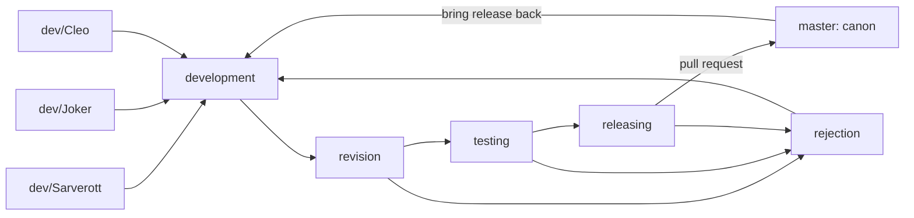

# bos-skillset — guide for technomancers

For people and AI agents developing **this repository**, including Joker
(GPT-6 family) and Cleo (Claude family). Sett Sarverott is the owner; use
**Sett** or **Sett Sarverott**. Read for intent, state consequential assumptions,
and give candid technical feedback. A shared name does not imply remembered sessions.

The workshop-wide `__WORKSHOP/AGENTS.md` applies; this file adds the local
rules. [BOS-CONTEXT.md](BOS-CONTEXT.md) and `skills/` are the instructions
we deliver to agents **using** BOS. Keep contributor policy and installed
skill context distinct.

## Begin a working round

1. Run `git status --short --branch`, inspect the tree and recent commits.
   Sett and other agents work in parallel. Preserve edits you did not make;
   re-read a file before changing it, staging it or switching branches.
2. Read [docs/devlog/README.md](docs/devlog/README.md), then the owner's
   `ORDERS.md` and `INQUIRIES.md`, the plan (`VISION`, `ROADMAP`, `TODO`),
   and open `BRAINSTORM` questions. A current instruction from Sett takes
   precedence over an older plan.
3. Read [docs/.agents/NOTES.md](docs/.agents/NOTES.md) for verified findings,
   and the relevant glossary page and skill. Load further references only
   when the task needs them.
4. When Sett hands over a tree with their own edits, run an
   [integration round](docs/guidelines/integration-round.md) first.
5. Work on your own `dev/<name>` branch from `development` (`dev/Joker`,
   `dev/Cleo`, `dev/Sarverott`). Integrate upstream changes without discarding
   anyone's work. Do not pull, stash or reset a dirty tree blindly.
6. Use `task --list` to discover this checkout's actual procedures. Check
   the installed core's `bos help` before documenting a command.

## The skillset and the core

```text
__WORKSHOP/
└── forge/
    └── blacksmith-organization-system/       scope: related repositories
        ├── blacksmith-organization-system/   core: TypeScript library + bos CLI
        └── bos-skillset/                     here: skills, adapters, docs
```

The core is the npm package `blacksmith-organization-system`. It owns models,
procedures, inspection, watching, versioning, the craft loop and devlog tools.
The skillset teaches how to use those capabilities and packages that knowledge
for agents. Taskfiles orchestrate tools; they must not become a second BOS engine.

Read the sibling core repository when a command, descriptor or behaviour is
unclear: start with its `AGENTS.md`, devlog and `src/tools/_index.ts`, then
verify the relevant source. Inspection is welcome; changes to that repository
belong to a separate task. Record core work here in `docs/ideas/` or the
workshop's `forge/NOTES-for-repositories.md` when writable.

The core's structural pattern is `BOS` → models (`Element`: directories,
children, descriptors) → named procedures (shared context and ordered steps)
→ tools → views. `Host` is the machine boundary; bridges reach outside
systems through it. Skills consume this interface rather than copying it.

| Place here | Responsibility |
| --- | --- |
| `skills/*/SKILL.md` | Portable Agent Skills for BOS elements and recurring workflows, with task-specific references |
| `assets/template/SKILL.md` | Starting shape for a new skill |
| `SKILL.md` (root) | The `bos-skillset` installation skill; the repository is also one skill |
| `.claude-plugin/` | Claude Code plugin and marketplace manifests |
| `.codex-plugin/` | Codex plugin manifest; a Codex-schema marketplace waiting for its place |
| `gemini-extension.json`, `BOS-CONTEXT.md` | Gemini extension and shared user context |
| `hooks/hooks.json`, `hooks/register.js` | SessionStart hook (Claude Code, Codex): install the pinned core, report the workshop |
| `.mcp.json`, `.app.json`, `.lsp.json`, `settings.json` | Adapter maps, deliberately empty until there is something real to declare |
| `package.json`, `package-lock.json` | Private tooling manifest pinning the core |
| `evals/evals.json` | skill-creator evals of the root skill |
| `CLAUDE.md`, `GEMINI.md` | Contributor entrypoints importing this guide |
| `docs/guidelines/` | Recurring procedures, such as an [integration round](docs/guidelines/integration-round.md) |
| `docs/glossary/` | Meaning of BOS elements; read Sett's annotations first |
| `docs/tutorials/`, `docs/infographics/` | Usage and explanations |
| `docs/devlog/`, `docs/.agents/` | Owner dialogue and plan; agents' findings |
| `docs/ideas/` | Proposals for capabilities, with their intended repository |
| `Taskfile.yml`, `docs/Taskfile.yml` | Public procedures and documentation tooling |
| `.github/workflows/checks.yml` | Checks actually wired into this repository |

## The BOS environment

```text
setternet: related hosts; each may hold independent workshops
└── __WORKSHOP/                   per user or mounted partition
    ├── .BOS/                    internal setup, data, nests, storylines
    ├── devarmory/               tools used to craft
    ├── forge/<scope>/<project>/ active work, grouped into families
    ├── craftbook/               scrapnotes, recipes, reusable craftsets
    └── archive/                 work at rest, mirrors, sarcophags
```

A project is a focused repository; a scope groups related projects and shared
arrangements. A sheme holds source material such as graphics or CAD; a
throwbox gathers loose material. A scrapnote can become a maintained document;
a craftset preserves a reusable working procedure. Definitions and unresolved
parts live in [the glossary](docs/glossary/README.md).

Elements are directories with descriptors: identity (`metadata.json`),
integrity (`manifest.json`), navigation (`.index.json`) and procedures
(`Taskfile.yml` or `.yaml`) where that element defines them. Local `.bos/`
and workshop `.BOS/` serve different levels. The core now supports an Omnis
seal at `.bos/.omnis.toml`; older glossary drafts still contain obsolete paths
and commands. Mark a discrepancy and reconcile meaning with current source;
do not turn an old example into a new requirement for every directory.

Before a workshop write, run `bos workshop locate` and inspect its reported
root and resolution source. Current core precedence is `--workshop`,
`BOS_WORKSHOP`, `WORKSHOP_ROOT`, nearest workshop ancestor, then the home
workshop; `WORKSHOP_RENAME` changes the directory name. `WORKSHOP_ROOT` names
the containing directory. Explicit `--workshop`/`BOS_WORKSHOP` values without
the workshop's name also resolve to a workshop beneath that directory.

Use a temporary workshop for examples and trials. Never bootstrap the home
workshop as a side effect of developing a skill. Preserve the standard areas,
keep workshops independent, and create only what is missing. For a tool with
a dry run, inspect that plan before the real write. `archive mirror --confirm`
can remove a forge copy: it requires Sett's authorization for that removal.
Keep credentials and private storylines out of commits and examples.

## The craft loop



Each contributor owns a `dev/<name>` branch; `development` accumulates checked
steps. `revision` reviews, `testing` verifies, `releasing` prepares the release,
and `master` is the stable spine of canon. Never commit or push directly to
`master`. Rejected work returns through `rejection` to `development`.
Use `development`, not the historical misspelling `developement`.

Finish a batch by checking the diff and merging the contributor branch into
`development` with `--no-ff` when integration is part of the task. Follow
[CONTRIBUTING](.github/CONTRIBUTING.md) for a pull request into `revision`;
advance the remaining stations by reviewed pull requests. Bring the released
state back into `development` before the next round. Do not rewrite shared
history or force-push to make the graph fit a diagram.

**What runs here today:** the checks workflow validates dependencies, skills
and docs. The default branch also carries repository triage workflows
(greetings, labels, stale issues and issue summaries). There is no local
`.github/bos.json`, commit-version hook or automatic release pipeline.
The core's default loop can explain directions; it does not prove that GitHub
will promote branches. In the core repository, the current release routine
uses the shorter `revision → master` route; do not silently apply that exception
here. Its nightly releases, mirrors, package publishing and per-commit bumps
are capabilities to adopt deliberately, not existing skillset automation.

Ordinary pushes to your own branch, `development` and `revision` are allowed
within the requested work. Ask Sett before changing remote settings, moving
`testing`/`releasing`, tagging, publishing or changing release policy, unless
Sett has already authorized that action. A loop's automerge flag is not
permission by itself.

### A step, a phase, a version

| Finished event | Project SemVer `X.Y.Z` | Scope GRIH `G.R.I.H` |
| --- | --- | --- |
| Step: one checked change, one commit | Z | H: Hooking |
| Phase: its TODO checklist complete | Y | I: Integration |
| Milestone | X | R: Reconstruction |
| Conceptual flip | X | G: Generation |

The core computes these scales. A scope's version lives in
`<scope>/.bos/scope.json`; branch policies live in `.github/bos.json` when
configured. Checking off a phase does not automatically run a bump.

Here one release version occurs in seven places: `.claude-plugin/plugin.json`,
its marketplace `metadata.version` and `plugins[].version`,
`gemini-extension.json`, `.codex-plugin/plugin.json`, `package.json` (with
`package-lock.json`), and `metadata.version` in the root `SKILL.md`. Update them together for a release. Do not copy the
core's package-only bump routine and claim it synchronizes plugin manifests.

## Devlog and the AI enclave

[docs/devlog/README.md](docs/devlog/README.md) defines the dialogue:

| Record | Purpose |
| --- | --- |
| `VISION.md`, `ROADMAP.md` | Purpose, milestones and phased direction |
| `TODO.md` | Work as `## Phase <n>: <title>` with `- [ ]` / `- [x]` items |
| `BRAINSTORM.md` | Unanswered `## Q<n>. <title>` questions, with a *Lean:* |
| `PROPOSALS.md` | `PP<n>` ideas for debate, separate from decisions |
| `ORDERS.md` | Sett's answers below the first `---` |
| `INQUIRIES.md` | Sett's requests below the first `---` |
| `STATE.md` | Generated view from `bos devlog state --write`; not committed |
| `docs/changelog/phase-<n>.md` | Append-only record of owner words and decisions, created when needed |

Take an inquiry into VISION/ROADMAP/TODO before implementation. Preserve
Sett's words verbatim in the phase changelog, with the answered question and
**Decision:** where applicable. Only then clear the processed inbox entries
and remove answered questions. Keep unprocessed material. Never reuse Q/PP
numbers or decide an unanswered question by implementing your preferred answer.
Mark unknowns `[TODO]` and interpretations *(assumed)*.

Use `UNIXUSAT=<milliseconds> · commit <hash>` for recorded committed steps;
use a real hash, and label uncommitted work as such instead of inventing one.
Owner edits being committed as their own changes belong on `dev/Sarverott`,
one coherent change per commit. This does not authorize staging arbitrary
owner edits: the requested scope and explicit exceptions still govern.

`docs/.agents/` is the AI enclave: agents write, Sett reads and answers in
the devlog. Keep shared findings in `NOTES.md` (dated, newest first), and
personal observations in `JOKER.md`, `CLEO.md`, or the contributor's own file.
Give evidence, separate assumptions from decisions, and keep historical notes
recognizable as historical. These files are context, not a second authority
that can overrule Sett. Never store transcripts, tokens or entire manuals there.

## Authoring skills and adopting concepts

Use the [Agent Skills specification](https://agentskills.io/specification).
Start with the glossary meaning and a real task; verify the corresponding
core capability; then write the skill and exercise its instructions.

- Put element skills in `skills/bos-<element>/SKILL.md` and reusable workflows
  in `skills/<workflow-name>/SKILL.md`. YAML frontmatter needs
  `name` matching its directory (lowercase letters, digits, single hyphens,
  1–64 characters) and `description` (1–1024 characters) saying what it does
  and when it should activate. Quote YAML values when punctuation requires it.
- Use optional `compatibility` for actual environment requirements. Keep
  client-specific settings in that client's adapter. `allowed-tools` support
  varies and does not grant authorization for an action.
- Keep essential decisions and a useful procedure in `SKILL.md`; aim below
  500 lines. Put detailed, maintained material in `references/` and output
  templates in `assets/`. Link relative to the skill root and say when to
  load each resource. Verify that installed users can reach those files;
  a sibling checkout or repository-root path is not automatically bundled.
- Prefer core commands to scripts. Small discovery helpers may remain when
  they have a clear fallback purpose; keep them thin and verify them. New BOS
  behaviour belongs in the core, with an idea or handoff recorded here.
- Try a representative request, an ambiguous trigger and a relevant failure
  or missing-tool case when changing a skill. Check the outcome and side
  effects. Discovery alone does not prove the instructions work.
- Adopt in checked steps: meaning → core support → skill → adapter and usage
  docs → validation. Label a proposal as a proposal until its implementation
  and packaging are verified. Keep existing unresolved TODOs visible.

## Taskfiles and dependency management

The existing entrypoints are:

| Command | Purpose |
| --- | --- |
| `task --list` | Discover public tasks |
| `task setup` | `npm ci`: install the pinned core into `node_modules` |
| `task bos -- <args>` | Run the pinned core (`npx --no-install bos`) |
| `task skills` | `npx -y skills add . --list --full-depth`; the root skill and all element skills must be found |
| `task plugin` | `claude plugin validate .` |
| `task docs:serve` | MkDocs preview |
| `task docs:build` | Strict documentation build |
| `task docs:lock` | Refresh the docs uv lock and exported requirements |
| `task docs:check-lock` | Verify that exported requirements match the source lockfile |
| `task check` | Lock/export consistency, skill discovery, plugin validation, strict docs build |

Use schema `version: '3'`, two spaces, public `desc:` entries, colon namespaces
and small included Taskfiles. Keep procedures visible through Task rather than
requiring people to memorize long shell sequences. `deps` can run concurrently;
ordered work belongs in `cmds` as `task:` calls. Each command has its own shell:
use `dir:` and `env:` rather than relying on a previous `cd` or `export`.
Forward arguments intentionally with `{{.CLI_ARGS}}`, validate necessary
inputs, and distinguish `preconditions` (may run) from `status` (already done).
Consult the [Task schema](https://taskfile.dev/docs/reference/schema) for the
installed version; retain links instead of committing printed manuals.

**Current dependency boundary:** root `package.json` is a private tooling
manifest whose one dependency is the core (`blacksmith-organization-system`
^1.11.0, which itself has none); `package-lock.json` pins it. `task setup`
(`npm ci`) installs it locally, and a global install is no longer needed here.
Docs use `docs/pyproject.toml`, `uv.lock` and the exported
`requirements.txt`. A plain skill install copies instructions; it does not
imply `npm install` or make `bos` available. The plugins' SessionStart hook
installs the pinned core into the plugin's data directory instead.

For npm adoption, prefer a private tooling manifest and committed lockfile,
with the core and required developer tools as explicit dependencies; use
`npm ci` for reproducible setup and Task wrappers for the local binaries.
Record the supported core version and Node requirement (the inspected core
requires Node ≥22.18). Verify published-package capabilities as well as source;
a sibling's unreleased feature is not an installed capability. Declare any
runtime dependency of a future executable adapter as a runtime dependency,
and verify how each plugin host obtains it. Do not restore the removed
bundled application or assume plugin hosts run package installation.
`hooks/register.js` is the one place that installs for a plugin host; keep it
thin glue, and move any BOS behaviour it grows into the core.

For update batches, follow [dependency maintenance](docs/guidelines/dependencies.md).
Dependabot tracks the docs' uv lockfile and groups routine updates; requirements
are exported from that resolution. npm updates of the root manifest are
configured on `development`. Activate configuration changes on the default
branch as well; Dependabot reads the former.

## Core tools worth harvesting

Confirmed against the sibling core 1.11.0 source and its `help` output;
re-check the version actually installed before use. `--dir=PATH` selects a
project for tools that expose it; `--workshop=PATH` selects a workshop.

| Core command | Role |
| --- | --- |
| `bos workshop locate`, `bos workshop status --all` | Locate and inspect |
| `bos workshop bootstrap --dryRun` | Plan missing workshop areas and descriptors |
| `bos workshop watch` | Observe events; `--record` additionally writes storylines |
| `bos flow explain`, `bos flow next dev/Joker` | Read the project's loop and next direction |
| `bos flow next-pr <branch> --dryRun` | Plan a GitHub pull request |
| `bos flow automerge <pr> --dryRun` | Evaluate a permitted loop merge |
| `bos flow bump <station> --dryRun`, `bos flow bump-commit --dryRun` | Plan configured package version bumps |
| `bos scope version <scope>`, `bos scope bump <scope> step --dryRun` | Read or plan a GRIH change |
| `bos devlog state` | Read phases, questions, proposals and waiting owner input |
| `bos project authors --dryRun` | Plan contributor credits |
| `bos project omnis`, `bos project seal --dryRun` | Compare or plan an integrity seal |
| `bos almanac rules`, `bos almanac judge "<case>"`, `bos almanac recall "<events>"` | Read rules, judge cases, recall recorded chains |
| `bos archive mirror <path> --dryRun` | Plan a bare archive mirror |
| `bos help` | Discover the actual tools and flags |

The almanac's verdict is evidence to interpret with the applicable rules and
Sett's instructions; it is not blanket permission. Unknown cases stay open.
Ideas such as `bos mcp`, workshop `open`/`close`, House CLI tools and automatic
skill drafting remain ideas here until verified in the core's tool registry.

## Finish a step

Run the relevant checks and `task check` before committing. Fix introduced
failures; report existing failures and unavailable checks accurately. Do not
bypass hooks with `--no-verify`. Inspect `git diff` and the staged diff; stage
explicit paths, one finished concern at a time. Use Conventional Commits
(`type(scope): subject`), explain purpose and consequential assumptions in
the body, and end agent-assisted commits with the agent's `Co-Authored-By:`
trailer using an established identity. Tick only work that has been verified.

For this cleanup, rewrite the assembled `AGENTS.md` and remove the printed
files under `docs/referencing-docs/` **before any commit**. Never preserve those
raw dumps in history or accidentally stage them with `git add .`. Keep concise
local findings and links to upstream sources instead.

Before calling an ollama resident, consult the House, now kept for the whole scope
in `forge/blacksmith-organization-system/.delegations/house/` (`HOUSE.md`, outside git), and the
relevant registry state. Only `active` residents may be called. The EON family
rests by its own decision: never call, prompt or inspect it.

Report what changed, what works, how it was checked, and what remains pending.
Usability includes being able to tell implemented behaviour from an idea.
