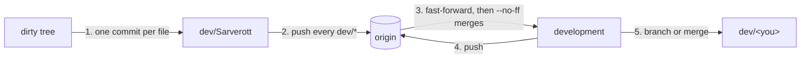

# Integration round

Sett often hands a contributor a tree that holds their own uncommitted
edits on top of another contributor's finished work, and asks to "commit it
and bring everything together". This is the standing procedure for that, so it
never has to be explained again. Run it before your own work in the round.



## 0. Look first

```bash
git fetch origin
git status --short --branch          # which branch the edits sit on, what changed
git log --oneline --graph --all -30  # who finished what; is origin ahead?
```

Every change in the tree is Sett's and intended: never discard, stash, reset
or "tidy" it. Read new files before committing them, and stop to ask if one
looks like a secret (keys, tokens, `.env`, private storylines).

## 1. Sett's edits → `dev/Sarverott`, one commit per file

Switch with the tree as it is; the edits travel with you:

```bash
git switch dev/Sarverott              # exists
git switch -c dev/Sarverott           # doesn't: start it where the edits sit
```

If `dev/Sarverott` exists and is behind the branch the edits were made on,
merge that branch into it first (`git merge --no-ff <branch>`), then commit.

Then **one commit per changed file**, each staged by its explicit path:

- list them with `git ls-files --modified`, `git ls-files --deleted` and
  `git ls-files --others --exclude-standard`; loop over that list, never over
  a shell glob (a glob over deleted files doesn't expand and sweeps a whole
  directory into one commit)
- a pure move (same content, new path) is one change: commit both paths together
- message: a conventional commit saying what the change *is*
  (`chore(house): remove HOUSE.md`, `feat(codex): add an empty Codex plugin manifest`).
  Don't invent a purpose Sett didn't state; empty placeholder files are
  committed as empty placeholders
- end with your `Co-Authored-By:` trailer; the author stays Sett (git config)

Nothing is pushed yet, so a mistake here can still be redone without
rewriting shared history.

## 2. Push every `dev/*` branch

```bash
for b in $(git for-each-ref --format='%(refname:short)' 'refs/heads/dev/*'); do
  git push -u origin "$b"
done
```

## 3. Bring `dev/*` into `development`

```bash
git switch development
git merge --ff-only origin/development      # origin may hold merged pull requests
git branch --no-merged development --list 'dev/*'
git merge --no-ff dev/<name> -F <message-file>   # for each one listed
```

- Always fast-forward from `origin/development` first. Pull requests (for
  example #31 from `dev/Joker`) land there without your local copy knowing.
- Use `--no-ff`, one merge per contributor branch, message
  `merge(dev/<name>): <what it brings>` plus the trailer. Write multi-line
  messages to a file and pass `-F`; quoting tricks in `-m` end up literally
  in the message.
- On a conflict, keep both contributors' work and say how you resolved it in
  the merge message. If you can't tell what both meant, stop and ask Sett.

## 4. Push `development`

```bash
git push origin development
```

Ordinary pushes of `development` are allowed; `revision`, `testing`,
`releasing` and `master` move only by reviewed pull requests (`AGENTS.md` at the repository root).
Never force-push.

## 5. Your own branch

```bash
git switch dev/<you> && git merge --no-ff development   # exists
git switch -c dev/<you>                                 # doesn't: start from development
```

Then adapt to the new state as the round's real work: read the devlog
(`docs/devlog/`), preserve Sett's request verbatim in
`docs/changelog/phase-<n>.md`, record findings in `docs/.agents/NOTES.md`,
and only then continue with the plan.

## If something goes wrong

- A local branch got commits that shouldn't be there and they are **not
  pushed**: rename it (`git branch -m <b> backup/<b>-<why>`) and recreate it from
  origin, rather than resetting with `--hard`. Nothing is lost, and Sett deletes
  the backup when satisfied.
- Already pushed: fix forward with a new commit. Don't rewrite shared history.
